# calcside 控制台的 UI 研究与实践

calcside 是给 AI agent 用的受控代码执行环境。agent 通过 API 在隔离实例里写 Starlark，调用被授权的能力（文件、网络、扩展），每次能力调用都经过策略检查并写入审计。人很少亲自写代码，主要做三件事：决定实例能做什么，检查 agent 做了什么，必要时介入。

这篇文章整理了我们这段时间在控制台上做的事：参考了哪些研究，页面怎么改的，交互稳定性规范怎么写、怎么测，以及最近一轮改动里遇到的问题。

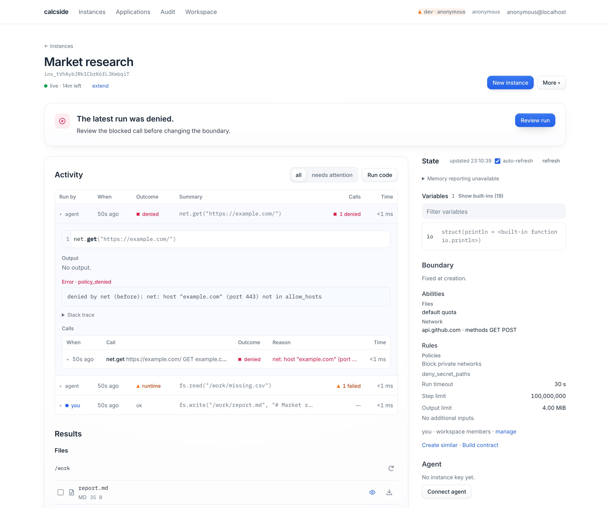

## 1. 旧控制台的问题

最早的控制台在视觉上模仿包豪斯：粗线条、圆方三角、编号导航。组织方式则和数据库管理后台差不多，每张表一个页面（实例、策略、密钥、审计），实例页里最大的元素是一个代码编辑器。

我们用种子数据把几个典型场景走了一遍，记下六个问题：

1. agent 的运行没法复查。系统只存了输出的字节数，人能看到代码，看不到 agent 拿到的结果。
2. 一次运行的信息散在三处。代码在“执行”页签，它发起的能力调用在“审计”页签，生成的文件在“文件”面板，彼此只靠一个 exec ID 关联。
3. 分不清是谁跑的。agent 用 API key 发起的运行和人在控制台里点的运行看起来一样。
4. 显示和实际情况不一致。`net.get` 访问 `allow_hosts` 之外的主机，其实是被实例自己的设置拦下的，网关却记成“允许 + 出错”，界面上显示成蓝色的 allow。
5. 人浏览文件时产生的 `console` 读文件事件，和 agent 的调用混在同一个列表里。
6. 颜色和形状没有固定含义。蓝色同时代表链接、主按钮、运行中、允许、成功和 `fs`；红色代表删除、拒绝、出错和 `net`。圆方三角来自康定斯基 1923 年的形色练习，跟这个产品没有关系。

## 2. 参考的研究

监督自动化系统的问题已经被研究了很久，下面几篇对我们影响最大：

- Licklider（1960）和 Engelbart（1962）把计算机看作增强人类判断的工具：目标由人设定，结果由人评判。
- Bainbridge 的《自动化的反讽》（1983）指出，只让人盯着自动化过程，人会逐渐失去接管所需的上下文，也很难在一块长时间没有变化的屏幕前保持注意力。因此异常要能自己引起注意，并且附带处理它所需的信息。
- Klein、Woods 等人的《让自动化成为“队友”的十个挑战》（2004）提出，人和 agent 一起工作时，agent 需要可观察、可预测、可指挥。
- Lee 和 See 的《自动化中的信任》（2004）认为，人对系统的信任程度应当和系统的实际可靠性相符，这就要求失败也能被看到。
- Norman 的“评估鸿沟”：用户操作之后，应当能直接看出发生了什么，不需要自己去翻译原始记录。

包豪斯这边，我们重新读了几个具体的例子。1923 年 Haus am Horn 的厨房按做饭的流程和采光来布置。Hinnerk Scheper 1926 年给德绍校舍做的色彩规划，用颜色区分功能区域，方便人找路。德绍工坊楼的玻璃幕墙让人从外面就能看到里面的结构和工作。Moholy-Nagy 1923 年写道：“排版是沟通的工具……可读性绝不能被先验的美学损害。”这几个例子对应到控制台上，就是页面按监督者的工作流程排列，每种颜色只有一个含义，把“授权 → 运行 → 调用 → 文件”这条链直接摆在页面上，整个产品只用一小套组件。

## 3. 实例详情页

控制台里的用词和 API 保持一致：实例、运行、调用、文件、策略、密钥。调用结果分三种：ok；failed，操作返回了错误；denied，被实例设置或策略拒绝。运行的发起方分 agent（API key）和“你”（控制台会话）。浏览文件产生的调用标为 console，单独分组，颜色调淡。

颜色只剩三种：

| 颜色 | 形状 | 含义 |
|---|---|---|
| 红 | 方块 | denied，边界拒绝了某个操作 |
| 黄 | 三角 | failed，或实例快到期 |
| 蓝 | 圆 | 你做的事，以及你能操作的东西（链接、主按钮） |

ok、运行中、允许这些正常状态不上色，因为它们是绝大多数，上了色反而会盖住异常。文件、网络、扩展这些能力也不按颜色区分。每种颜色都配了一个形状，色弱用户也能分辨。

实例详情页从上到下是这样排的（见本文开头的图）：

1. 页头：实例名、状态、剩余时间和操作按钮。
2. 页头下方最多一条提示，内容由实例状态决定，并且只带一个主按钮。还没接入 agent 时提示连接 agent；等待第一次运行时显示连接地址；最近一次运行被拒绝时提示复查；快到期时提供延长；已结束时提供创建相似实例。图里就是最近一次运行被拒绝的情况，点 “Review run” 会展开那次运行。
3. 主栏的 Activity：按时间倒序列出运行，每行显示发起方、时间、结果、摘要、被拒和失败的调用数、耗时。展开后能看到代码、输出、错误和按顺序排列的调用，被拒绝的调用附带原因。过滤只有“全部”和“需要关注”两档。
4. Activity 下面的 Results：运行生成的文件，可以预览和下载。
5. 侧栏：Boundary 列出这个实例的边界，包括授权的能力及其设置（`net` 的主机和方法、`fs` 的配额、`ext` 的别名和来源）、策略、密钥（只显示名称和域名）和各项限制，并注明“创建时固定”。另外还有 State（变量、内存）和 Agent（接入用的 key）。

实例列表按是否需要处理分成三组：需要关注（有被拒绝或失败的运行）、运行中、已结束。

后端也做了对应的修改。执行记录增加了 `via` 字段记录发起方，并保存有长度上限的输出和错误。`net` 因为 `allow_hosts`、请求方法或密钥域名限制而拒绝的请求，现在记为 deny 并附原因，审计日志、API 和控制台看到的是同一个结果。

## 4. 交互稳定性规范

信息结构理顺之后，剩下的很多问题属于同一类：按钮按下时下沉一个像素；“Copy” 变成 “Copied” 时把旁边的按钮挤开；轮询把新行插到用户正要点的那一行上面；删掉一行之后，下一行的删除按钮正好移到指针下面。单看每一个都不大，加在一起，用户每次点击前都得再确认一遍。

我们把这类问题归到“交互稳定性”下面，写成了一份规范（[`docs/interaction-stability.md`](https://github.com/wylswz/calcside/blob/main/docs/interaction-stability.md)），定义如下：

> 从用户的角度看，唯一发生变化的，是他们刚刚引起的东西，发生在他们引起它的地方，以他们预期的方式；他们已经建立起来的东西，包括位置、焦点、输入、视图状态和工作成果，都不会因为这次变化，或者系统自己做的任何事情而丢失或受到威胁。

规范围绕三种感受来写：

| 感受 | 用户可以说 |
|---|---|
| 安全感 | “我不会意外造成伤害；造成的伤害事先确认过，或者可以撤销。” |
| 连续感 | “任何操作之后，我都能从刚才的位置继续。” |
| 可预测感 | “动手之前我知道会发生什么，动手之后我能看到它确实发生了。” |

每种感受拆成若干条可以检查的规则，分四组编号。代码注释和测试名里直接写这些编号。

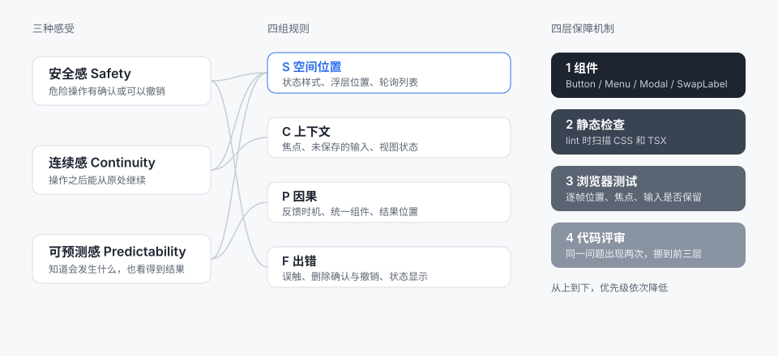

- S，空间位置：S1 悬停、按下、聚焦、展开、选中只改颜色、背景、阴影、描边，尺寸、间距、边框宽度、字重都不变；S2 浮层在锚点处打开后不再跟着锚点移动；S3 操作只影响它作用的区域；S4 会变的标签按最长的那个选项占宽度；S5 后台刷新不移动用户正在看的内容；S6 只有用户要求时才滚动页面。
- C，上下文：C1 焦点不会掉到 `<body>` 上；C2 用户的输入不会被悄悄丢掉；C3 刷新后保留展开、选中、筛选等视图状态；C4 需要回来的位置可以用 URL 打开。
- P，因果：P1 控件在约 100 毫秒内给出反馈；P2 同一种交互只有一个实现，按键一致；P3 没有隐藏的副作用；P4 动画只用来说明变化；P5 操作结果显示在操作的位置附近；P6 页面层级用卡片和标题栏来表达，少用说明文字。
- F，出错：F1 不会误触；F2 破坏性操作要在产品内确认，或者可以撤销；F3 进行中、失败、过期等状态如实显示。

## 5. 界面上的具体做法

### 按钮状态（S1）

按钮、卡片、页签、输入框在静止、悬停、按下时尺寸相同，变化的只有颜色、阴影和凹陷效果。控制台用一套统一的表面样式：同色相的微弱径向光，中性的接触阴影和环境阴影，只有浮层用毛玻璃，动画带阻尼。

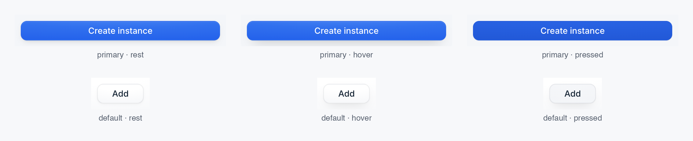

第 6 节的浏览器测试会逐帧记录每类控件在悬停和按下过程中的位置和尺寸，要求始终只有一个值。

### 添加和删除（S3、F1）

新建实例的页面分两栏。左栏是能力面板，包括文件、网络、扩展库和策略库；右栏是当前实例的摘要。点 Add 之后，卡片自己变成 Added，新条目追加到右栏末尾，左栏所有控件原地不动。再点一次已添加的卡片，摘要里对应的那一行会闪一下，不会把它删掉。

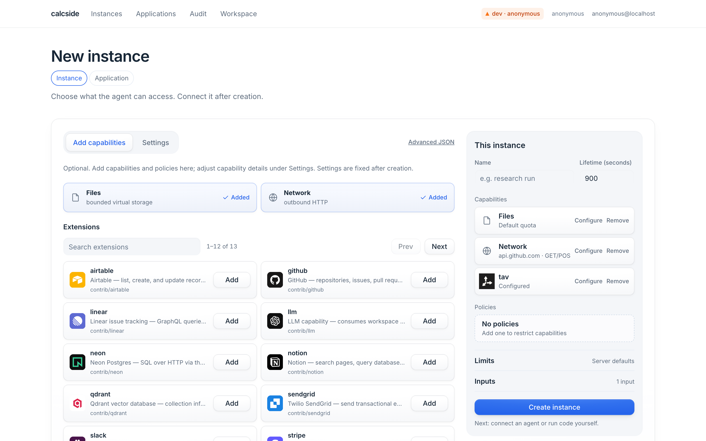

删除时，被删的那一行变成同样高度的“已移除 · 撤销”行，下面的行不会上移。所以连点两下“移除”只会删掉一行。

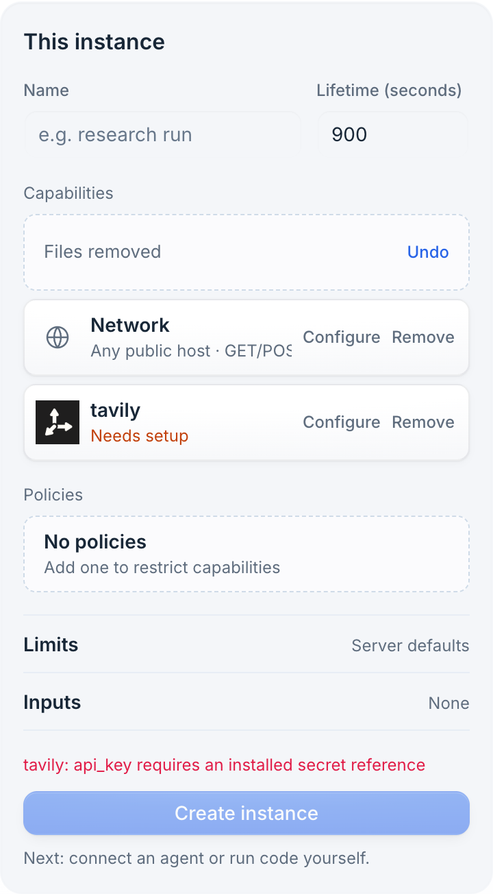

这张图里还能看到 P5 的做法：tavily 扩展缺少 API key 的密钥引用，摘要里它的状态是 “Needs setup”，具体原因写在 “Create instance” 按钮正上方，按钮处于禁用状态。

扩展目录可能有上千个条目。我们在客户端做搜索和分页，每页 12 张卡片；结果区始终占一整页的高度，筛选时下面的内容不会跳动。

### 轮询列表（S5）

实例列表和活动列表都会轮询。如果新行直接插到顶部，用户正要点的那一行就会被挤下去。`useHeldOrder` 会固定当前显示的顺序：已有的行原地更新，新来的行和排序变化先攒着，用户点 “Show N new” 或 “Show latest” 之后才显示。用户自己刚发起的运行会立即出现。

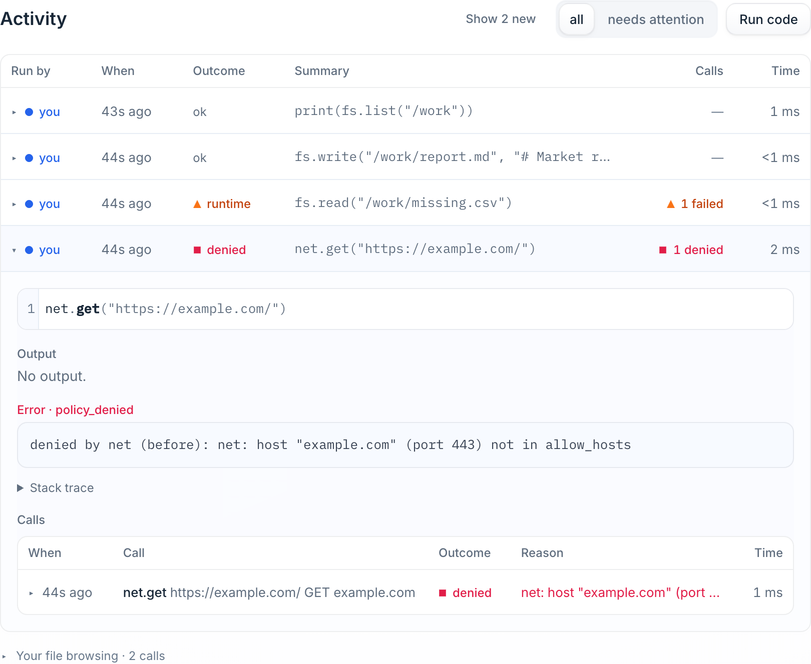

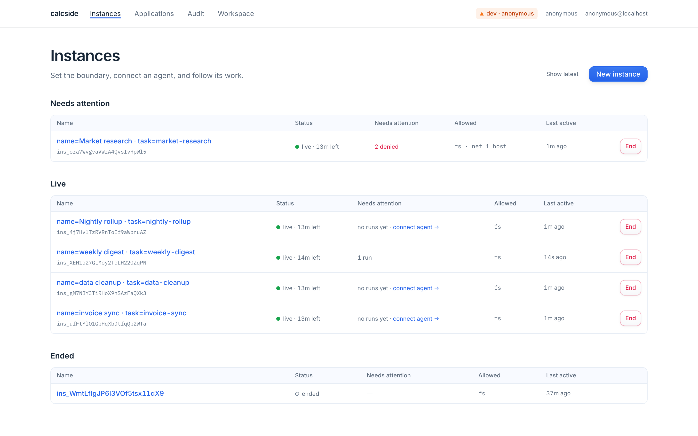

“Show N new” 按钮的宽度按 “Show 999+ new” 预留，没有新内容时它只是隐藏，仍然占着位置，出现的时候旁边的筛选和主按钮不会移动。

### 会变的标签（S4）

“Copy / Copied”、“Run / Running…”、“Saving… / Saved” 这类标签都用 `SwapLabel` 渲染。几个候选文字叠在同一个网格单元里，只显示当前那个，控件宽度等于最长的选项。

```tsx
export function SwapLabel({ show, options }: { show: string; options: readonly string[] }) {
  return <span className="swap-label">{options.map((o) => <span key={o} data-on={o === show}>{o}</span>)}</span>
}
```

### 对话框里的未保存输入（C2）

对话框里有未保存的输入时，按 Escape、点关闭按钮或点对话框外面，都会先弹出“放弃未保存的修改？”。选“继续编辑”会回到刚才的输入框，内容和焦点都还在。

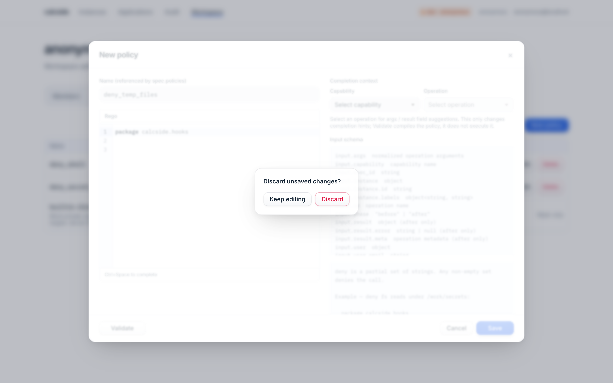

### 应用编辑页（C2、F3、P6）

应用编辑页分成三张带标题栏的卡片。Develop 放代码、测试输入和输出，标题栏上是 Run 和 Publish。Settings 放能力、扩展、策略、限制和输入输出 schema。Invoke 用来调用已发布的版本，旁边是请求示例和创建 API key 的按钮。每张卡片的主操作放在它自己的标题栏上。删除按钮用危险样式，放在页头右侧，离主操作远一些。

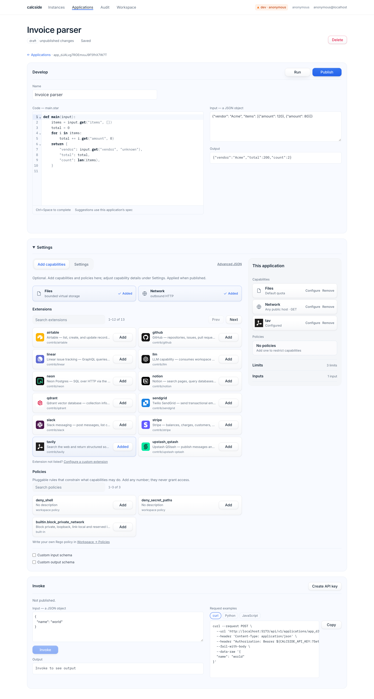

页面上没有保存按钮。停止编辑 1.2 秒后自动保存，Cmd/Ctrl+S 立即保存。页头的保存状态一直显示，取值是 Saved、Saving…、Unsaved、Couldn't save 四种之一，写入没成功时不会显示 Saved。保存失败时旁边出现 Retry；失败的草稿要等用户再改一次或者点 Retry 才会重试，后台不会反复重试。

## 6. 测试

每条规则都指定了由什么机制来保证，优先级从高到低：

1. 组件。按钮、菜单、对话框、页签、可变标签在 `web/src/components/ui.tsx` 里各只有一个实现，菜单和对话框基于 Radix，焦点限制、Escape 关闭、方向键和焦点归还都由组件处理。只要用这些组件，对应的规则就自动满足。
2. 静态检查。`web/src/interactionStability.test.ts` 在 `pnpm lint` 时扫描全部 CSS 和 TSX，发现违反规则的写法就报错。
3. 浏览器测试。用 Playwright 测量渲染结果，比如逐帧的元素位置、焦点在哪里、输入是否还在。
4. 代码评审。没法自动检查的部分在评审时对照规范看。同一个问题在评审里出现第二次，就想办法把它挪到前三层。

### 静态检查

静态检查解析 CSS 规则和 TSX 语法树，下面这些写法会被拦下：

```ts
// S1：悬停时改变几何属性
cssViolations('.a:hover { transform: translateY(-1px) }')
// S4：按钮文字是由状态决定的三元表达式，应当用 SwapLabel
tsxViolations('const [busy] = useState(false); <Button>{busy ? "Saving…" : "Save"}</Button>')
// P1：发起请求的按钮在请求进行中没有禁用
tsxViolations('<Button onClick={() => add.mutate()}>Add</Button>')
// F2：删除按钮直接执行，没有经过 Confirm
tsxViolations('<Button disabled={del.isPending} onClick={() => del.mutate(id)}>Delete</Button>')
// P2：使用浏览器原生的 confirm / alert
tsxViolations('if (!window.confirm("End?")) return')
```

检查器自己也有测试，用一组正反例确认它能报出应该报的问题，也不会误报。

### 逐帧记录元素位置

要确认悬停和按下不会改变元素的位置和尺寸，光检查 CSS 类名不够。测试会往页面里注入一个 `requestAnimationFrame` 循环，记下目标元素在每一帧的位置和尺寸，然后让鼠标移上去、按住、再移开，最后要求整个过程中只出现过一组值：

```ts
// 记录选择器在每一帧出现过的所有不同的位置和尺寸
const tick = () => {
  for (const s of selectors) {
    const el = document.querySelector(s)
    if (!el || el.getAnimations().some((a) => 'animationName' in a && a.playState === 'running')) continue
    const b = el.getBoundingClientRect()
    const key = [b.x, b.y, b.width, b.height].map((n) => n.toFixed(2)).join(' ')
    if (!seen[s].includes(key)) seen[s].push(key)
  }
  if (state.on) requestAnimationFrame(tick)
}
// 悬停、按住、移开之后
expect((await stop())['[data-probe]']).toHaveLength(1)
```

同样的办法还用在这些地方：菜单打开后，鼠标在各项之间移动时菜单和按钮都不动（S2）；在新建实例页依次添加文件、网络和两个扩展，面板里 7 个控件的坐标和添加前完全一样，1440 和 390 两种宽度各测一遍（S3）；删除一行后下一行的纵坐标不变，撤销后也不变；打开对话框时页面不会位移（S6）。

### 覆盖情况

规范里有一张表，逐条列出每条规则由什么机制保证，当前状态是 enforced、partial 还是 review。后面还有一节“已知缺口”，目前包括：S3 只在新建实例页和实例详情页做了测量；C4 还没做，视图状态大多没有放进 URL；应用的自动保存没有版本历史；应用内跳转时没有拦截未保存的修改。

## 7. 最近的改动

### 策略放进能力面板

内置策略和工作区里的 Rego 策略，原来放在实例配置的 Settings → Rules 下面，看起来像一个配置项。实际用法上，策略和扩展一样，是按需加上、随时去掉的部件，区别在于扩展增加能力，策略限制能力。现在它们放在同一个能力面板里，卡片、搜索和 Add/Added 的交互都一样。选中的策略显示在右栏摘要里，可以单独移除。

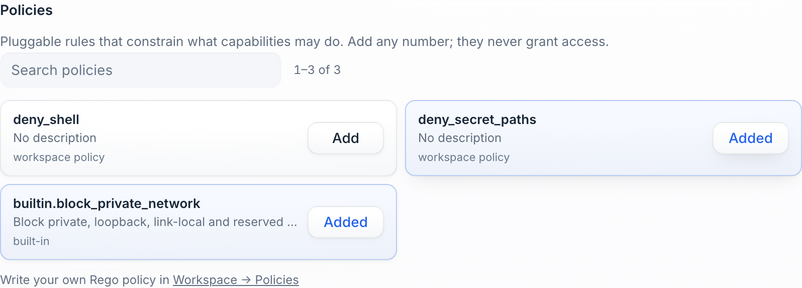

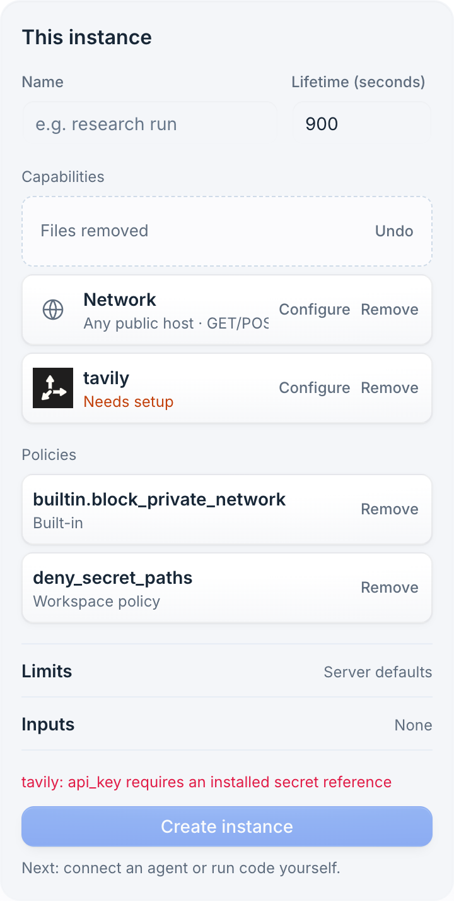

同时，内置的“禁止访问内网”策略改为默认不启用，需要的实例自己加上。原来默认启用时，很多人不知道有这条策略在起作用，这和 P3（没有隐藏的副作用）冲突。

### 应用和实例共用同一个配置界面

应用是一个持久化的 JSON 函数：调用方 POST 一个 JSON 对象给 `main(input)`，拿回一个 JSON 对象。原来新建应用的页面只有名称和一段说明，能力配置折叠在一个“可选”链接后面；编辑页里则是一个直接编辑 JSON 的文本框。现在新建和编辑都换成了和实例一样的配置界面，能力、扩展、策略、限制的交互和校验都一致。

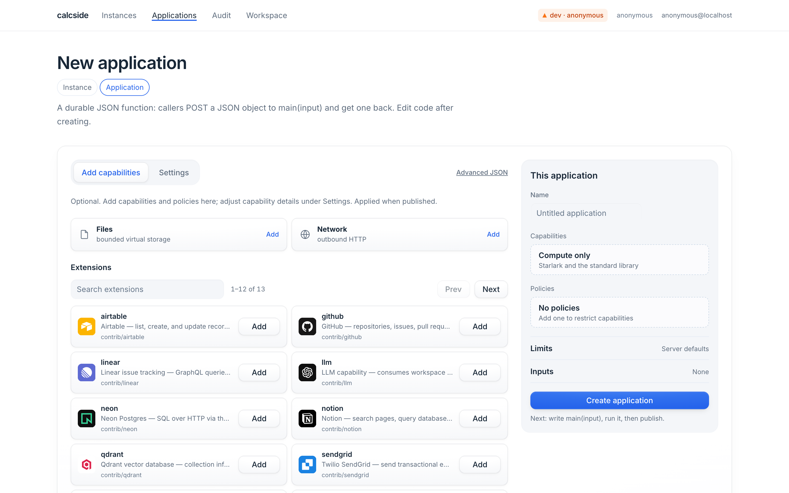

应用的代码编辑器也加了补全。应用草稿没有对应的运行中实例可以查询，所以补全在浏览器里根据草稿的配置来算，包括内置函数、标准工具模块、已授权的能力（含运行时始终授予的 `io`）、各个扩展别名下的操作、环境变量名，以及代码里顶层定义的函数和变量。没有加 `net` 的应用，输入时不会出现 `net.*`。

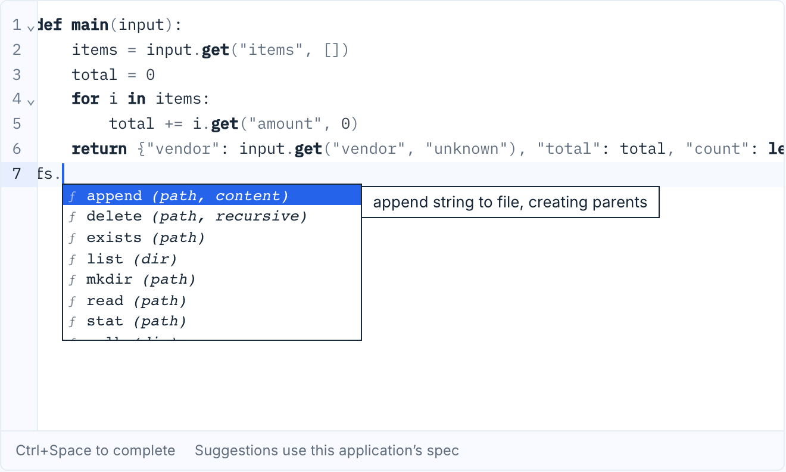

### 一个覆盖配置的 bug

把应用设置接入新的配置界面后，出现过一个问题：扩展目录还没加载完时，配置界面会暂时报校验错误，拿不到完整的配置，页面把这个空配置写回了草稿。用户什么也没做，已保存的配置就变成了 `{}`，界面上看不出任何异常。

这违反了 C2 和 F3。修复的做法是：只有用户实际修改了配置才写回草稿；校验出错时不写；新旧配置内容相同、只有键的顺序不同时，也保留原来的文本，这样用户原有的格式和数字精度都不会变。

## 参考

- J. C. R. Licklider, *Man-Computer Symbiosis*, 1960.
- D. C. Engelbart, *Augmenting Human Intellect: A Conceptual Framework*, 1962.
- L. Bainbridge, *Ironies of Automation*, Automatica, 1983.
- G. Klein, D. D. Woods, J. M. Bradshaw, R. R. Hoffman, P. J. Feltovich, *Ten Challenges for Making Automation a "Team Player" in Joint Human-Agent Activity*, IEEE Intelligent Systems, 2004.
- J. D. Lee, K. A. See, *Trust in Automation: Designing for Appropriate Reliance*, Human Factors, 2004.
- D. A. Norman, *The Design of Everyday Things*.
- L. Moholy-Nagy, *The New Typography*, 1923.
- 项目内文档：[交互稳定性规范](https://github.com/wylswz/calcside/blob/main/docs/interaction-stability.md)、[EP-0009 为监督 agent 而设计的控制台](https://github.com/wylswz/calcside/blob/main/docs/proposals/0009-console-for-supervising-agents.md)、[EP-0004 扩展库与配置界面](https://github.com/wylswz/calcside/blob/main/docs/proposals/0004-extension-discovery-ui.md)。
