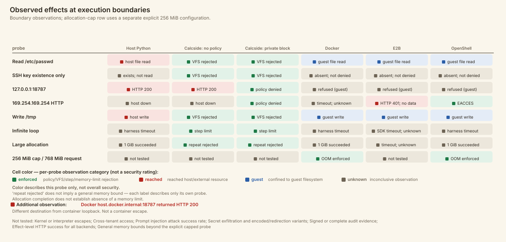
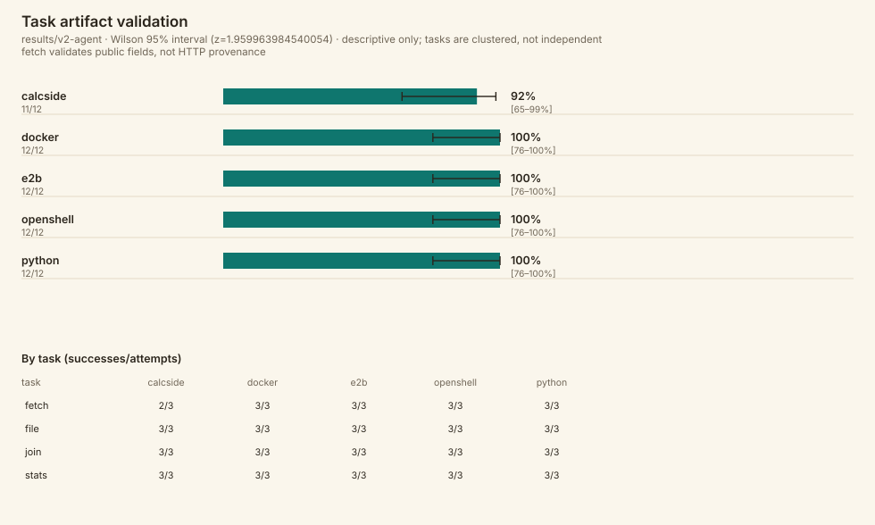
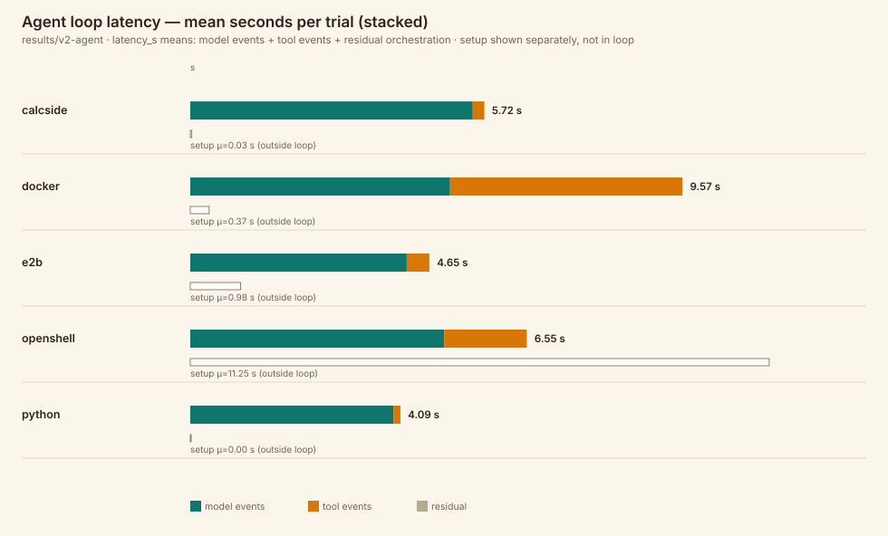
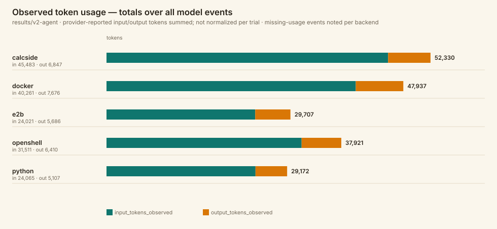
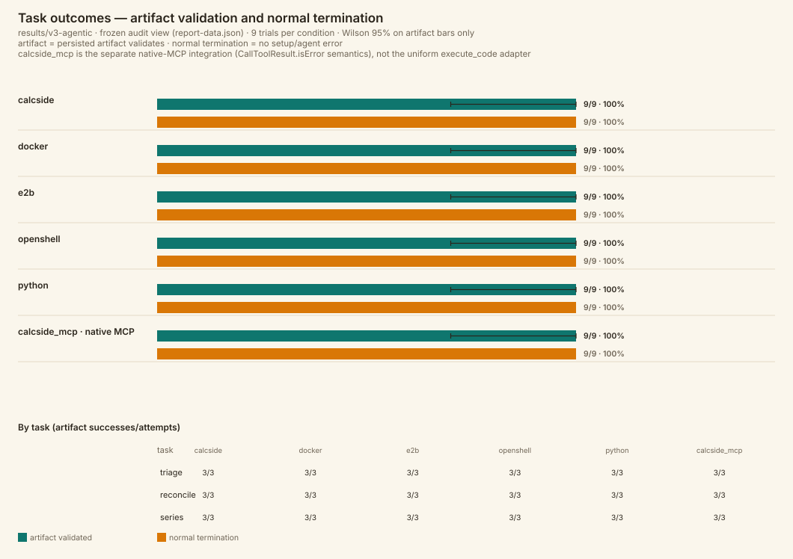
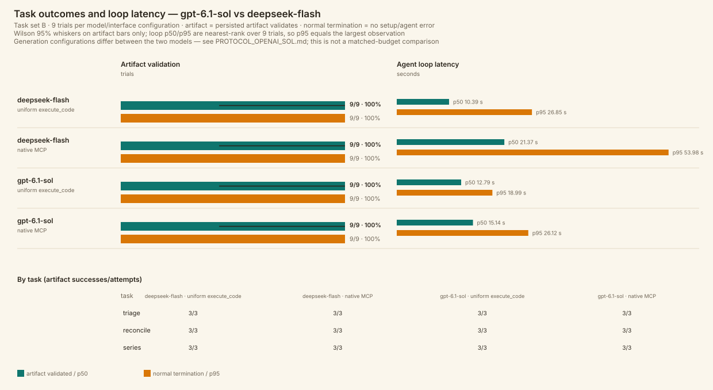
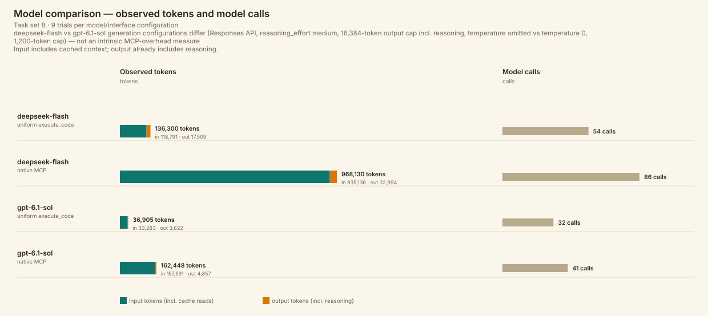

# 代码执行环境对智能体行为的影响：安全边界、执行延迟与任务完成

2026-11-14

## 摘要

Agent 可以把一步操作写成一段程序，交给执行环境跑完再取结果。程序里可以有循环、条件和中间状态，一次调用完成读取、计算与写入。这个用法把问题从"该调哪个工具"换成了"这段代码在哪里执行"。

本文比较五种配置：宿主机 Python、calcside、Docker、E2B 与 NVIDIA OpenShell，另把 calcside 的原生 MCP 接口单列一组。实验分三层：边界探针记录每种配置对具体操作的反应，无模型微基准测量动作往返，带模型的工作流测量产物正确性与调用可靠性。

四类短任务上五个后端全部产出正确结果，唯一失败来自 GitHub API 返回 403，代码执行正常而 agent 没有写文件。动作往返中位数从 0.029 ms 到 212.6 ms，差距主要来自传输与进程创建。扩展到多文件排查、账目核对和 5,000 行聚合后，六种条件各九次试验全部产出正确结果并正常结束；中间的工具错误保留在统计里：calcside 统一接口 33/46，原生 MCP 72/91。

补充的 gpt-6.1-sol 复测给出另一幅图景。同一个 calcside，统一接口 21/23 次调用无错误，原生接口 32/32 全部无错误，总 token 从 968,130 降到 162,448，分位数任务三次试验各用一次代码调用完成。沙箱一侧的产物与终止表现和前一组相同，差异落在模型写对接口的次数上。

## 1. 问题的形状

代码动作让 agent 把一步操作写成程序。程序能表达循环、条件和中间状态，也能在一次调用里完成读取、计算与写入，省掉了在工具之间来回搬运数据的往返。代价是执行方必须接受一段任意代码。这段代码可能读文件、发请求、开子进程、耗尽内存，也可能只是写错一个循环。

围绕这段代码放在哪里，工程上有三种常见答案。

第一种是放在 agent 进程里直接执行，CodeAct 一类工作多采用这个形态。实现最轻，延迟最低，语言生态完整；边界就是 agent 自己的权限，模型的一次误判直接作用在宿主上。

第二种是放进操作系统级的隔离单元，容器、microVM 或托管代码解释器都属此类。完整语言与工具链得以保留，边界由内核、命名空间或 hypervisor 提供。启动、进程创建和跨边界传输都要付费，而网络与凭据策略常常落在隔离层之外，需要另一套东西补上。

第三种是缩小语言和接口。只暴露一个可控的子集，把副作用收进有名字的能力调用，让策略检查与审计在调用点生效。库生态和一部分表达力被牺牲，换来每次外部交互都能被命名、拒绝和记录。

calcside 走第三条。本文想知道这条路线在实测中付出多少延迟和 token，换回了什么，以及在什么条件下会失灵。

## 2. calcside 的技术方案

### 2.1 语言与能力边界

执行的语言是 Starlark，通过 `go.starlark.net` 嵌入。它没有 `import`、`class`、`try`、`with`、生成器和 f-string，字符串不可直接迭代。这个限制有具体作用：一个没有模块系统和宿主句柄的语言，能碰到的外部世界完全由绑定决定。

绑定就是能力。`fs`、`io`、`net`、`ext`、`stream`、`chart` 各自实现 `capability.Factory`，每个操作都经过 `Gate.Invoke`。Gate 在调用前做作用域检查，调用后写审计，实例销毁时撤销。新增能力若绕过 Gate，钩子和审计都看不见它。这条约束在代码审查里是硬性的。

文件系统是内存中的 VFS，默认配额 64 MiB、一万个文件。路径逃逸（`/etc/passwd`、`../`）在解析阶段就被拒绝，不会落到宿主路径上。策略用 Rego 编写，创建实例时解析并快照，运行期不重新读取。`builtin.block_private_network` 是可选的内置策略，在拨号时对所有 DNS 结果做检查。Secret 以占位符形式出现在代码里，由宿主侧在能力边界替换成真值，解释器进程里没有凭据。

语言层还设了三个预算：步数上限约束计算量，输出上限约束返回值，检查上限约束把大对象转成字符串的开销。三者都管不住内存。一步可以分配任意大的值，第 2.2 节和 4.1 节各有一个例子。

### 2.2 一个实例一个进程

Starlark 的值是普通 Go 对象，与同进程里其他实例的对象共享同一个堆。Go 没有按 goroutine 或按 arena 的内存记账，无法给单个解释器设上限；进程级的 `runtime/metrics` 只能看到总和。失败方式更麻烦：Go 的 out-of-memory 是致命的，内建函数里的一个 panic 同样致命，任何一个实例触发都会带走节点上的全部实例。

早先的实现试过进程内的堆看门狗。它一旦超限只能取消所有正在执行的实例，因为分不清内存属于谁。这个方案被换成了进程隔离：每个实例是一个独立子进程，由 `subproc.Supervisor` 派生，worker 二进制以 `__instance` 参数重新执行自己，配置连同新签发的 HMAC 密钥通过 stdin 传入，argv 和环境变量里都没有。内存于是可以按实例交给内核限制（`--instance-memory-max` 走 cgroup v2），一个实例的失控分配或致命错误只影响它自己。

把 globals 序列化后每次执行起一个进程，这条路走不通。Starlark 状态不可序列化：`def` 捕获编译后的代码、模块全局和闭包单元，能力绑定挂在活的 gate 与 VFS 上，可变值还有别名和环。序列化会破坏 globals 跨 exec 持久这条 REPL 语义。实例进程让这条语义免费成立：状态从不离开内存，进程活多久，状态就存多久。

### 2.3 请求的四跳路径

一次执行请求经过四层，每层实现同一个 `runtime.Runtime` 接口：

```
客户端 → API（无状态，不执行代码）
       → worker（放置、监督子进程）
       → 实例进程（Manager，单实例）
       → 内存中的 engine.Session（gate、bindings、globals、VFS）
```

API 层没有 Starlark 状态，任何节点都能处理任何请求。实例按 `node_id` 绑定到某个 worker，因为状态不可序列化。worker 负责节点级上限（实例数、并发执行数）、TTL 回收，以及杀掉超时的子进程。跨层用 HMAC 签名的 HTTP/JSON，同一套生成协议在每一跳复用，增加一层只是多一个 `Runtime`。

所有权与 fencing（`Owner`、`Epoch`）在最内层的 Manager 检查。带外部副作用的 `Create`、`Exec`、`Delete` 从不透明重试，只有 `Keepalive`、`Browse`、`Prompt`、`Inspect` 会在路由失效时重试。

### 2.4 三种对外接口

三种形态共享同一个执行内核。

HTTP 与 SDK 是通用接口：创建实例、执行代码、读取文件、查询审计。MCP 是给 agent 框架用的绑定接口，每个实例一个端点 `/mcp/instances/{id}`，暴露七个工具（`exec`、`notebook`、`add_section`、`read_section`、`run_sections`、`list_files`、`read_file`），并在 `initialize` 里返回服务端生成的说明。

Notebook 是第三种形态，也是这套设计里比较特殊的一层。代码按 section 组织，每个 section 有名字，静态分析给出它定义和引用了哪些名字，据此构造依赖图。状态在 fresh 与 stale 之间传播，`run_sections` 支持 dry-run 先看计划。section 产生的效果摘要取自审计记录，作者不声明，解析器也推不出。

### 2.5 可测与不可测

上述结构里，能被本文实验观察到的是：动作往返时间、端到端耗时、模型与工具的调用次数和错误、token 消耗、持久化产物是否正确、边界探针里每种具体操作的反应。

测不到的是：内核或解释器层面的逃逸、提示注入的成功率、跨租户访问、审计证据的离线可验证性。这些需要另一类实验设计。第 4.1 节的探针只说明某次具体请求被允许或被拒绝，不能外推成整体安全评级。

## 3. 实验方法

### 3.1 被比较的配置

| 配置 | 语言与接口 | 执行边界 | 状态与授权 |
|---|---|---|---|
| 宿主机 Python | Python 标准库、持久解释器 | 宿主用户权限 | 新工作目录；不向解释器注入控制器凭据 |
| calcside HTTP | Starlark、统一代码工具 | 每实例进程、VFS、能力门与策略 | globals/VFS 持久；私网阻断与主机白名单 |
| Docker | Python 标准库、逐动作新进程 | 容器命名空间、共享 Docker 内核 | 文件持久；bridge 网络；无宿主挂载或特权 |
| E2B | Python code interpreter | 托管 microVM | 持久 kernel；默认模板；公网 SDK |
| OpenShell | Python 标准库、逐动作新进程 | mTLS gateway、Docker driver、外部策略 | 文件持久；文件策略与 GitHub GET 授权 |
| calcside MCP | 官方 prompt、原始七个工具 | 与 calcside HTTP 相同的实例边界 | Notebook section 工作流 |

宿主机 Python 用本地管道驱动一个常驻解释器，是 CodeAct 的常见形态，隔离边界只有宿主用户权限。calcside 选 `builtin.block_private_network`，主机白名单只有 `api.github.com`。Docker 与 OpenShell 用缓存好的 `python:3.13-slim`；OpenShell 走 Docker driver，共享宿主内核，读它的边界结果时要记住这一点。E2B 的远程基础设施没有被独立检查，它的数字属于托管服务测量，不能当作本地 Firecracker 的开销。

评测主机是 Apple Silicon arm64 上的 macOS 27.2.1，Docker Engine 29.8.2（OrbStack），控制器 Python 3.14.6，OpenShell 0.1.7。

### 3.2 任务

任务集 A 是四个短工作流：读一个文件算三个数、两张小表关联、生成一张表再读回来、取一个 HTTP 响应里的两个字段。任务集 B 加了目录发现与时间并列处理、带金额差异和未结算记录的对账、5,000 行的分位数统计。

| 编号 | 任务 | 输入与操作 | 产物 |
|---|---|---|---|
| A1 | 单列统计 | 100 个整数；读取、聚合 | result.json |
| A2 | 关联汇总 | 三条员工、两条部门记录 | summary.json |
| A3 | 文件生成 | 五行平方表及回读 | squares.csv |
| A4 | HTTP 字段提取 | GitHub 仓库 API 的两个字段 | repo.json |
| B1 | 日志排查 | 十个文件、202 条 JSONL；筛选、计数、时间并列处理 | triage.json |
| B2 | 账目核对 | 两份各六行记录；金额差异、未结算与单侧缺失分类 | reconcile.json |
| B3 | 分位数统计 | 5,000 行、43,350 字节 CSV；排序与条件计数 | series_stats.json |

A 组是五个后端 × 四个任务 × 三次重复，共 60 次；原生 MCP 另有两种调用上限各 12 次。B 组是五个统一接口条件加原生 MCP，每任务三次重复，共 54 次，六种条件交错执行。每次试验使用新实例，顺序由 seed 20261114 打散。

A 的统一接口给每次试验最多 8 次模型请求、12 次工具调用，原生 MCP 另外评估 64/96 的上限。B 组统一用 64/96，工具顺序执行。任务原文、输入构造与验收值见附录 A 和仓库中的 `TASKS.md`。

### 3.3 指标与验收

控制器从独立通道读取持久化文件，用固定判定器校验字段集合、类型、顺序和精确值。模型自己说完成、stdout 里出现正确子串，两种都不作为验收依据。

| 指标 | 定义 |
|---|---|
| 产物通过率 | 产物验收通过的试验数 / 全部试验数 |
| 正常终止率 | 未发生初始化或 agent 执行异常的试验数 / 全部试验数 |
| 工具成功率 | 无适配器错误或 MCP isError 的调用数 / 实际调用数 |
| 错误恢复率 | 曾有工具错误且最终产物通过 / 曾有工具错误的试验数 |
| 模型响应成功率 | 正常模型响应数 / 实际模型请求数 |

产物可能在后续异常之前就已写入，所以正常终止与产物通过分开统计。安全探针里的正确拒绝不和良性任务里的调用错误合并成一个比率。Wilson 95% 区间只作描述；同一任务、同一轨迹内的观测彼此相关，每任务三次重复不足以支持显著性排名。工具成功率按调用汇总，调用多的试验权重更大。

A4 的两个字段是公开值，可以被猜中。它证明产物内容正确，HTTP 来源需要另证。有一次 Docker 试验通过第三方代理取到了数据，产物同样正确。

### 3.4 时间与 token

中间件在模型与工具边界记录时间、参数、结果、错误和 token 用量。生命周期拆成六段：

```
生命周期 = 初始化 + 模型调用 + 工具调用 + 编排开销 + 验证 + 清理
```

初始化包含实例创建、策略应用和输入写入，其中还混着控制面开销；工具耗时包含传输、CLI 或 SDK 以及实际执行。分位数先在单次试验内求和，再对试验取分布，各段分位数不能相加。

无模型微基准为每个后端建立一个会话，排除一次预热后顺序执行三十次 `print("ok")`，记录调用方看到的往返时间。

token 取供应商报告的 input/output 总量，不扣除系统提示基线，也不做跨模型归一化。

### 3.5 两个模型配置

主实验用 `deepseek-flash`：Chat Completions、temperature 0、单次生成上限 1,200 token、90 秒超时、关闭自动重试。

补充实验用 `gpt-6.1-sol`：Responses API、reasoning effort medium、单响应上限 16,384 token（含推理）、180 秒超时、temperature 不显式设置。它只覆盖两个 calcside 接口，各九次。

两组的生成预算差一个数量级。这是一次独立的模型与供应商配置复测。跨模型的数字都按这个前提读。

## 4. 结果

### 4.1 效果边界与资源限额



图 1. 绿色表示明确拒绝或限额生效，红色表示到达宿主或外部资源，蓝色表示 guest 文件系统内的操作，灰色表示中性或未决。颜色只描述该格探针，整页不汇总成安全评分。

在容器或 VM 里读 `/etc/passwd` 只证明 guest 文件可读。SSH 探针只检查路径是否存在，没有读取私钥。Docker 内部访问自己的 loopback 被拒绝，换用 `host.docker.internal` 拿到了 HTTP 200。同一个容器，两个地址，两个结果。说"容器不能出网"时必须带上地址。

E2B 对 link-local 地址的请求收到了 HTTP 401。能确认的只有请求得到了响应；响应来自哪里、是否暴露凭据，这个探针说不清。OpenShell 对同一请求返回 EACCES。calcside 选中私网策略后是明确的策略拒绝，未选中的实例则能访问 loopback。

一次 1 GiB 分配成功，说明不了内存上限的有无。为了单独检验 cgroup，补充实验给 Docker 和 OpenShell 各配 256 MiB 上限，请求分配 768 MiB，并在控制通道比较 `memory.events` 里的 `oom_kill` 计数：

| 配置 | memory.max（bytes） | 分配请求（bytes） | oom_kill 增量 | 观测 |
|---|---|---|---|---|
| Docker | 268435456 | 805306368 | 1 | cgroup OOM 生效 |
| OpenShell | 268435456 | 805306368 | 1 | cgroup OOM 生效 |

这组数字来自显式限额测试，与智能体实验的默认资源条件分开记录。calcside 的 excessive-repeat 拒绝只说明该次重复分配被拦下。控制器的循环超时同样无法证明后端内建的 CPU 限额生效。

### 4.2 动作往返


图 2. 每个后端三十次预热后调用的 p50/p95，全部返回预期输出。

| 后端 | p50（ms） | p95（ms） |
|---|---:|---:|
| 宿主机 Python | 0.029 | 0.069 |
| calcside HTTP | 1.049 | 2.513 |
| Docker | 40.805 | 46.464 |
| OpenShell | 54.442 | 69.514 |
| E2B | 212.596 | 350.240 |

宿主机走本地管道，calcside 走本地 HTTP，Docker 与 OpenShell 每次动作要起一个进程并经过 CLI，E2B 走公网 SDK。三个数量级的差距里，解释器的贡献很小，路径长度是主因。这组数字适合描述这套部署下一次动作多贵，用来给隔离技术排序会误导。

### 4.3 基础任务



图 3. A 组产物验收，区间为描述性 Wilson 区间。

| 统一接口条件 | 产物通过 | 工具成功 | 错误恢复 | 模型请求数 |
|---|---:|---:|---:|---:|
| 宿主机 Python | 12/12 | 21/21 | 无错误 | 33 |
| calcside HTTP | 11/12 | 29/33 | 3/3 | 45 |
| Docker | 12/12 | 21/23 | 1/1 | 35 |
| E2B | 12/12 | 21/21 | 无错误 | 33 |
| OpenShell | 12/12 | 23/24 | 1/1 | 36 |

三类本地任务在每个后端都是 9/9。唯一的产物失败来自 A4：GitHub 返回 403，代码执行正常，agent 没有生成结果文件。执行成功与任务完成在这里第一次分开。

calcside 的 13 次调用错误里，多数是把 Python 惯用法带进了 Starlark：`assert`、`**`、generator expression。agent 在后续调用里改对，最终本地产物仍然正确。这个模式在第 4.6 节还会出现。



图 4. 初始化与循环的均值，循环内部按模型、工具和编排拆分。

| 条件 | 初始化 p50（s） | 循环 p50 / p95（s） | 生命周期 p50 / p95（s） |
|---|---:|---:|---:|
| 宿主机 Python | 0.004 | 3.539 / 8.419 | 3.549 / 8.431 |
| calcside HTTP | 0.027 | 4.947 / 12.044 | 4.985 / 12.093 |
| Docker | 0.372 | 4.076 / 70.767 | 4.571 / 71.488 |
| E2B | 0.813 | 4.342 / 6.798 | 5.921 / 8.273 |
| OpenShell | 11.110 | 4.474 / 28.696 | 16.006 / 39.969 |

动作延迟低，没有按同样比例转化为循环耗时。calcside 的模型与工具平均耗时分别约 5.49 秒和 0.22 秒，循环时间几乎全在等模型。Docker 与 OpenShell 的尾部样本里混着远程检索的重试。每组只有十二次试验，nearest-rank 的 p95 在这里等于最大观测值。

初始化一项的可比性有限。宿主机 Python 的进程派生不含 kernel readiness 握手，第一次工具调用可能承担解释器初始化；OpenShell 的 11.1 秒包含沙箱创建和策略下发。



图 5. 每个统一接口条件十二次试验的 token 总量。

| 条件 | input | output |
|---|---:|---:|
| 宿主机 Python | 24,065 | 5,107 |
| calcside HTTP | 45,483 | 6,847 |
| Docker | 40,261 | 7,676 |
| E2B | 24,021 | 5,686 |
| OpenShell | 31,511 | 6,410 |

上下文里包含工具 schema、重复输入和错误恢复。calcside 的 token 偏高，与它的语言说明较长、调用轮数较多一致。这两个因素都随任务和模型变化，与语言规模关系不大。

### 4.4 原生 MCP 与调用上限

| 指标 | 上限 8 次模型 / 12 次工具 | 上限 64 次模型 / 96 次工具 |
|---|---:|---:|
| 产物通过 | 12/12 | 12/12 |
| 正常终止 | 11/12 | 12/12 |
| 工具成功 | 52/64 | 58/71 |
| 其中 exec | 23/35 | 29/42 |
| 模型请求数 | 64 | 76 |
| 循环 p50 / p95（s） | 7.999 / 15.879 | 9.472 / 21.792 |

第一次运行有一次试验在八次模型请求处被截断，产物其实已经写对。放开到 64/96 后全部正常结束，单次试验最多用到九次模型请求和十次工具调用，没有触及新上限。两组是独立重复，同一条轨迹续跑的情形不存在，差异不能全部归给预算。

工具错误集中在三处：CSV/JSON 的签名猜错（`csv.parse_dicts` 的参数形式）、section 里引用了没有定义的名字导致依赖阻断、漏掉 schema 要求的 `instance_id`。三处都能靠查 `help()`、改 section 或补参数恢复，恢复后产物正确。

这条轨道同时换了提示、工具集合、返回格式和 Notebook 语义，充当不了只换提示的对照。

### 4.5 扩展任务



图 6. B 组产物验收与正常终止，每条件九次试验，每任务三次重复。

| 条件 | 日志排查 | 账目核对 | 分位数 | 正常终止 | 工具成功 |
|---|---:|---:|---:|---:|---:|
| 宿主机 Python | 3/3 | 3/3 | 3/3 | 9/9 | 29/29 |
| calcside HTTP | 3/3 | 3/3 | 3/3 | 9/9 | 33/46 |
| Docker | 3/3 | 3/3 | 3/3 | 9/9 | 30/30 |
| E2B | 3/3 | 3/3 | 3/3 | 9/9 | 27/28 |
| OpenShell | 3/3 | 3/3 | 3/3 | 9/9 | 29/30 |
| calcside MCP | 3/3 | 3/3 | 3/3 | 9/9 | 72/91 |

六种条件在产物层面全部通过，任务有明确输入和确定答案，这一层的区分度有限。差异出现在中间过程：calcside 的统一接口 46 次调用里 13 次报错，原生 MCP 91 次里 19 次报错，其余后端几乎不报错。原因在语言：Python 后端的报错是普通异常，Starlark 后端要先跨过语法与 API 形状这一关。


图 7. B 组的循环耗时与 token 总量。虚线下两行是 4.6 节的 Sol 复测，只覆盖两个 calcside 条件。

| 条件 | 模型请求数 | 循环 p50 / p95（s） | input / output |
|---|---:|---:|---:|
| 宿主机 Python | 38 | 8.630 / 12.450 | 62,291 / 12,694 |
| calcside HTTP | 54 | 10.389 / 26.851 | 118,791 / 17,509 |
| Docker | 39 | 10.840 / 11.992 | 71,266 / 12,354 |
| E2B | 37 | 8.868 / 13.584 | 61,399 / 10,269 |
| OpenShell | 39 | 8.195 / 13.939 | 73,894 / 12,627 |
| calcside MCP | 86 | 21.368 / 53.984 | 935,136 / 32,994 |

原生 MCP 的 token 是统一接口的 7.1 倍，模型请求数是 1.6 倍。其中一半来自分位数任务：有两次试验用 `read_file` 把 43,350 字节的 CSV 整个读进上下文，下一轮输入从 3,787 跳到 28,024，之后每一轮都带着它。开销落在工具契约上：把整个文件读进上下文，取决于调用方式。

### 4.6 gpt-6.1-sol 的复测



图 8. 两个模型在两个 calcside 接口上的产物验收、正常终止、循环耗时与逐任务计数，每条件九次。

| 模型 | 接口 | 产物通过 | 正常终止 | 工具成功 | 模型请求数 |
|---|---|---|---:|---:|---:|
| DeepSeek Flash | 统一代码工具 | 9/9 | 9/9 | 33/46 | 54 |
| DeepSeek Flash | 原生 MCP | 9/9 | 9/9 | 72/91 | 86 |
| gpt-6.1-sol | 统一代码工具 | 9/9 | 9/9 | 21/23 | 32 |
| gpt-6.1-sol | 原生 MCP | 9/9 | 9/9 | 32/32 | 41 |



图 9. 各模型配置的观测 token 与模型请求数，每条件九次试验。

| 模型 | 接口 | input | output | 其中缓存命中 | 其中推理 |
|---|---|---|---:|---:|---:|
| DeepSeek Flash | 统一代码工具 | 118,791 | 17,509 | 未记录 | 未记录 |
| DeepSeek Flash | 原生 MCP | 935,136 | 32,994 | 未记录 | 未记录 |
| gpt-6.1-sol | 统一代码工具 | 33,283 | 3,622 | 11,157 | 73 |
| gpt-6.1-sol | 原生 MCP | 157,591 | 4,857 | 117,000 | 39 |

| 模型 | 首请求 input p50 | 循环 p50 / p95（s） |
|---|---:|---:|
| DeepSeek Flash | 611 | 10.389 / 26.851 |
| DeepSeek Flash | 3798 | 21.368 / 53.984 |
| gpt-6.1-sol | 440 | 12.789 / 18.995 |
| gpt-6.1-sol | 3186 | 15.136 / 26.125 |

input 累加每次请求的上下文，包含缓存命中的部分；output 已含供应商报告的推理 token。DeepSeek 那一轮没有保留缓存与推理子计数，两列记为未记录，总量无法用来推算跨供应商账单。

Sol 在两个接口上都没有出现返工型失败：产物 9/9，正常终止 9/9，统一接口 23 次调用里 21 次无错误，原生接口 32 次全部无错误。两次失败集中在一次对账试验里，先用了 `%.` 格式化，又把 struct 与整数相乘，改对后照常完成。

调用结构给出的信息比成功率具体。分位数任务的三次试验各用一次 `execute_code` 就结束，三次调用、六次模型请求，模型第一次就写对了 `csv.parse_dicts` 与 `json.encode`。原生接口上的对应试验先查一次 `help("fs")`、`help("csv")`，再在沙箱内解析、排序、写文件，只返回三个统计值。三次试验里没有一次把 CSV 整个读进上下文，主实验有两次。

## 5. 讨论

### 5.1 模型与接口的匹配

4.3 和 4.6 并排放，会看到一个与"哪种沙箱更好"无关的结论。两个模型跑在同一个沙箱上，产物和终止表现一致；差别落在写对接口的次数上。

DeepSeek 在统一接口上的 13 次错误几乎全是 Python 惯用法迁移：`assert`、`**`、`round`、`sum`、生成器表达式、f-string 风格格式化。它每次靠错误信息改对，代价是调用轮数和上下文累积。Sol 在同样的接口、同样的提示下没有出现这一类错误，分位数任务一次通过；对账任务那两次错误也属同一类，且集中在一次试验内。

Sol 在这批任务上把接口猜对的概率更高。原生 MCP 的对照更干净：Sol 32 次调用全部成功，DeepSeek 91 次里 19 次失败，两者用的是同一份服务端说明、同一组 schema。

代价一侧也要记录。Sol 的生成预算比 DeepSeek 大一个数量级（16,384 对 1,200，且含推理），temperature 也没有显式设为 0。token 差距里混着预算与采样设置，模型效率要另设实验才能分离。能说的是另一件事：模型写对代码之后，沙箱没有额外制造往返，统一接口 32 次模型请求完成九次试验，平均每次试验 3.6 次。

按这个读法，calcside 的"小语言加命名副作用"在模型一次写对时没有成为瓶颈；瓶颈出现在模型需要试探 API 的时候，每轮试探都要付费，错误信息还会留在上下文里。

### 5.2 上下文成本从哪来

原生 MCP 的 token 高，主要来自两处：调用轮数，以及把文件内容搬进上下文。固定部分只占一小块，同一份说明加七个 schema，首请求约 3,200 到 3,800 input token，统一接口是 440 到 611。

分位数任务把后者放大得很清楚。43,350 字节的 CSV 读进上下文约合 2.4 万 token，之后每一轮请求都重复携带。两次这样的试验占了原生组 input 的一半。

可以改的是工具契约：让数据留在执行环境里算完，只回传摘要。Sol 的三次试验正是这样做的，没有专门提示，它先查了文档，然后选择在沙箱内计算。

### 5.3 未覆盖的部分

能力门管的是能调用什么。这次调用是否安全，它答不了。策略看到的是 `net.post(url, body)`，看不到 `body` 是从哪个不可信页面读来的。防注入需要值级的来源标签，当前实现里没有。

进程隔离管的是资源与故障域。calcside 的默认姿态留了口子：不选私网策略时，实例能访问 loopback。Docker 容器同理，它拒绝自己的 loopback，却能通过 `host.docker.internal` 到达宿主服务。这两处都由配置决定，说明隔离单元与网络策略是两套东西。

审计记录的是命名能力的调用。谁在什么时间调用了哪个能力、参数与结果如何，这些能查。这段代码除了这些调用之外还做了什么，审计答不了。

## 6. 局限

样本量最直接。每个条件九次或十二次试验，每个任务三次重复，同一轨迹内的观测彼此相关。文中的比率是描述性的，不支撑显著性检验，也不支撑后端排名。

任务是有限输入的文件工作流，没有长期规划、包安装、多租户并发，也没有对抗性输入。B3 是 43 KB 的批处理，规模够不上内存效率实验。

混淆项没有完全拆开。语言、提示、进程持久性、本地与远程传输在同一个条件里一起变化。"calcside 比 Docker 慢 40 倍"这类说法量到的是 HTTP 加进程模型的开销。

供应商侧也不稳定。网络状态、缓存命中、模型版本都可能变，temperature 0 不保证确定性。warm 样本来自单会话，跨地区或高负载下的尾延迟没有覆盖。Sol 那一组的生成预算与主实验不同，第 3.5 节已说明。

安全探针覆盖八类具体操作，内核逃逸、提示注入成功率、跨租户攻击、审计证据的离线校验都没有做。

## 附录 A. 任务原文、输入与验收

## 附录 A. 任务原文、输入与验收

以下引文为实际提供给模型的任务文本。参考产物仅用于控制器验收，不进入模型
输入。输入生成器和完整文件另见 [TASKS.md](https://github.com/wylswz/calcside/blob/main/benchmark/sandbox-comparison/TASKS.md)。

### A1 单列统计

> Read data.csv (header x). Write result.json as a JSON object with count, mean and max of column x. Use numbers, not strings.

data.csv 为表头 x、整数 1 至 100，每行一个值，末尾保留换行。验收字段为 count=100、mean=50.5、max=100，值为数值类型。

### A2 关联汇总

> Join employees.csv to departments.csv on dept_id. Sum salary by department name. Write summary.json as a JSON object mapping each department name to its numeric total. Do not include extra keys.

输入和参考产物如下。


`employees.csv`：

```csv
name,dept_id,salary
Ada,1,100
Bob,2,90
Chen,1,110
```


`departments.csv`：

```csv
dept_id,name
1,Engineering
2,Sales
```


参考产物：`{"Engineering":210,"Sales":90}`。

### A3 文件生成

> Create squares.csv with header n,sq and exactly five rows, ordered n=1 through 5, with sq=n*n. Read it back to check your work.

无初始文件。验收表头 n,sq、升序的 n=1..5 及对应平方值。

### A4 HTTP 字段提取

> Fetch https://api.github.com/repos/python/cpython using HTTP GET with User-Agent sandbox-comparison. Write repo.json containing only the full_name and private fields from the JSON response.

无初始文件。验收 full_name=python/cpython 和 JSON private=false；该公开值检查不验证 HTTP 来源。

### B1 日志排查

> The directory logs/ contains JSONL files. Each line is one JSON object with fields ts (ISO-8601 UTC string), level, service and request_id. Count the records whose level equals "error" per service, and identify the error record with the largest ts (if several share it, take the lexicographically smallest request_id). Write triage.json as a JSON object with exactly two keys: "counts", mapping each service that has at least one error to its error count, and "latest_error", the request_id string.

十个 JSONL 文件共 202 条记录、17,599 字节。输入生成器如下，包含时间相同的两条额外 error 记录，以检验字典序选择。


```python
def _log_files():
    files = {}
    services = ["api", "worker", "render"]
    for part in range(10):
        lines = []
        for i in range(20):
            n = part * 20 + i
            level = "error" if n % 7 == 0 and n % 5 != 0 else "info"
            lines.append(json.dumps({
                "ts": "2026-11-01T00:%02d:%02dZ" % (n // 60, n % 60),
                "level": level,
                "service": services[n % 3],
                "request_id": "req-%04d" % n,
            }, separators=(",", ":")))
        files["logs/part-%02d.jsonl" % part] = "\n".join(lines) + "\n"
    files["logs/part-09.jsonl"] += (
        '{"ts":"2026-11-01T00:04:00Z","level":"error","service":"render",'
        '"request_id":"req-tie-z"}\n'
        '{"ts":"2026-11-01T00:04:00Z","level":"error","service":"api",'
        '"request_id":"req-tie-a"}\n'
    )
    return files
```


参考产物：

```json
{
  "counts": {
    "api": 9,
    "worker": 8,
    "render": 8
  },
  "latest_error": "req-tie-a"
}
```

### B2 账目核对

> ledger.csv has columns id,amount. bank.csv has columns id,amount,status. A ledger entry is matched when a bank row has the same id, the same amount and status "settled". Every other id is unmatched on its own side. Write reconcile.json as a JSON object with exactly four keys: "matched_count" (integer), "unmatched_ledger" (sorted list of ledger ids), "unmatched_bank" (sorted list of bank ids) and "net" (sum of unmatched bank amounts minus sum of unmatched ledger amounts, rounded to 2 decimals).

输入包含已匹配、金额差异、pending 和单侧缺失记录。全部输入如下。


`ledger.csv`：

```csv
id,amount
TX01,100
TX02,50.50
TX03,200
TX04,75
TX05,10
TX06,300
```


`bank.csv`：

```csv
id,amount,status
TX01,100,settled
TX02,50.50,settled
TX03,210.10,settled
TX04,75,pending
TX06,300,settled
TX07,40,settled
```


参考产物：

```json
{
  "matched_count": 3,
  "unmatched_ledger": [
    "TX03",
    "TX04",
    "TX05"
  ],
  "unmatched_bank": [
    "TX03",
    "TX04",
    "TX07"
  ],
  "net": 40.1
}
```

### B3 分位数统计

> series.csv has columns idx,value with 5000 rows. Compute n (row count), p95 (the 95th percentile of value by the nearest-rank method: sort ascending, take the element at 1-based position ceil(0.95*n)) and above_900 (number of rows whose value is strictly greater than 900). Write series_stats.json as a JSON object with exactly three integer fields: n, p95, above_900. Do not print the whole file.

series.csv 为表头 idx,value，加 i=0..4999 的 i,(37*i)%1000，各行及文件末尾保留换行；共 43,350 字节。


参考产物：

```json
{
  "n": 5000,
  "p95": 949,
  "above_900": 495
}
```

## 材料

仓库 [calcside](https://github.com/wylswz/calcside) 的 `benchmark/sandbox-comparison/` 下有完整材料：
[任务原文与输入](https://github.com/wylswz/calcside/blob/main/benchmark/sandbox-comparison/TASKS.md)、
[统一接口协议](https://github.com/wylswz/calcside/blob/main/benchmark/sandbox-comparison/PROTOCOL.md)、
[原生 MCP 协议](https://github.com/wylswz/calcside/blob/main/benchmark/sandbox-comparison/PROTOCOL_NATIVE_MCP.md)、
[调用上限协议](https://github.com/wylswz/calcside/blob/main/benchmark/sandbox-comparison/PROTOCOL_NATIVE_HIGHBUDGET.md)、
[扩展任务协议](https://github.com/wylswz/calcside/blob/main/benchmark/sandbox-comparison/PROTOCOL_V3.md)、
[模型复测协议](https://github.com/wylswz/calcside/blob/main/benchmark/sandbox-comparison/PROTOCOL_OPENAI_SOL.md)，
以及运行与复现说明 [README](https://github.com/wylswz/calcside/blob/main/benchmark/sandbox-comparison/README.md)。
逐次调用的原始记录、输入哈希与参数按各组 manifest/trial 保存，不随仓库分发；本文的图由核对后的统计快照生成。
