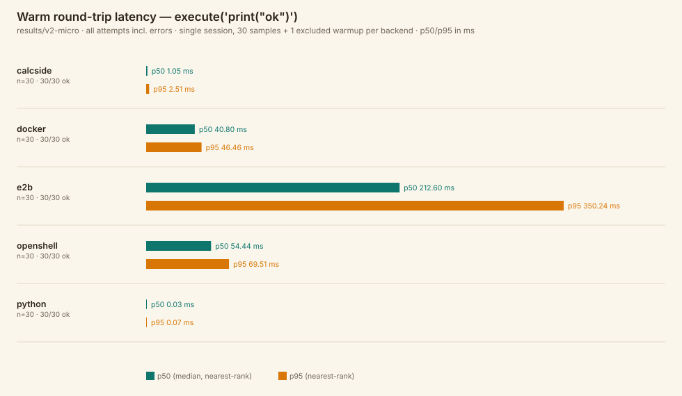
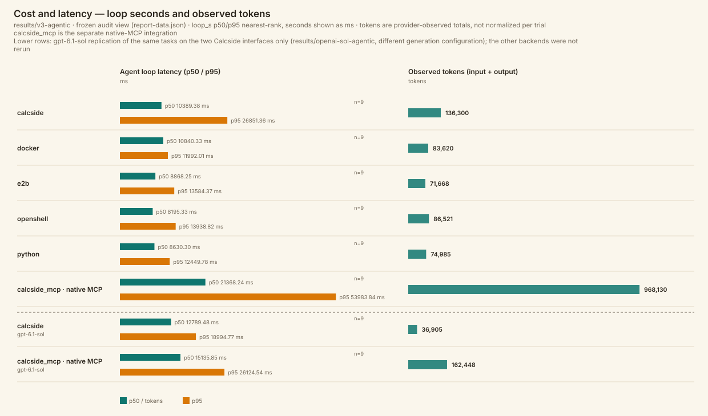

# 代码执行环境对智能体行为的影响：安全边界、执行延迟与任务完成

2026-11-14

## 摘要

本文比较 Host Python、Calcside、Docker、E2B 和 NVIDIA OpenShell
五种执行配置，考察效果边界、动作往返延迟及智能体任务表现。研究采用边界探针、
无模型微基准和带模型工作流三类实验，通过独立控制通道校验持久化产物。基础
任务中，五个后端的三类本地数据任务均通过全部九次验收；动作往返延迟中位数
介于 0.029 ms 与 212.596 ms。原生 MCP 在较高调用上限下通过全部十二次基础
任务验收并正常终止，但工具成功率为 81.69%。扩展实验纳入日志排查、账目核对
和分位数统计，在六种接口条件下共运行 54 次试验。结果区分产物正确性、
正常终止和中间调用可靠性；语言接口、状态持久性与传输路径共同影响端到端表现。

补充实验以 `gpt-6.1-sol` 对两个 Calcside 接口复测十八次，保留原有任务与判定器，单独记录缓存和推理 token；结果见第 4.6 节。

## 1. 研究范围

CodeAct 是以可执行代码组织动作的交互方式，容器和 microVM 则约束代码运行
的系统环境。Calcside 将动作限制在 Starlark 与显式能力接口内，OpenShell
在代码进程之外实施权限策略。这些机制处于不同抽象层，可以组合。本文比较
具体部署配置，不将其视为互斥技术。

研究问题包括：各配置暴露哪些文件、网络及资源效果；动作延迟与智能体总耗时
之间有何关系；执行接口和任务类型如何影响任务完成与错误恢复。

| 配置 | 语言与接口 | 执行边界 | 状态与授权 |
|---|---|---|---|
| Host Python | Python 标准库、持久解释器 | 宿主用户权限 | 新工作目录；不向解释器注入控制器凭据 |
| Calcside HTTP | Starlark、统一代码工具 | 每实例进程、VFS、能力门与策略 | globals/VFS 持久；私网阻断与主机白名单 |
| Docker | Python 标准库、逐动作新进程 | 容器命名空间、共享 Docker Linux 内核 | 文件持久；bridge；无宿主挂载或特权 |
| E2B | Python code interpreter | 托管 microVM | 持久 kernel；默认模板；公网 SDK |
| OpenShell | Python 标准库、逐动作新进程 | mTLS gateway、Docker driver、外部策略 | 文件持久；文件策略与 GitHub GET 授权 |
| Calcside MCP | 官方 prompt、原始七个 MCP 工具 | 与 Calcside HTTP 相同的实例边界 | Notebook section 工作流 |

评测主机为 Apple Silicon arm64 / macOS 27.2.1，Docker Engine 29.8.2
（OrbStack），控制器 Python 3.14.6，OpenShell 0.1.7。Docker/OpenShell
使用已缓存的 `python:3.13-slim`。E2B 的基础设施未被独立检查，其结果属于
托管部署测量，而非本地 Firecracker 的独立开销。

Calcside 选择 `builtin.block_private_network`，主机白名单为
`api.github.com`，地址策略例外集合为 `198.18.0.0/15`。OpenShell 授予
`api.github.com:443` 上 `GET /repos/**` 的权限，工作目录为 `/sandbox`。
资源限额补充探针采用独立配置，不与智能体实验的默认资源条件混合。

## 2. 安全模型

### 2.1 对手、资产与可信计算基

对手可生成任意任务代码，并可通过代码读取的内容影响后续决策。保护对象为
宿主文件、控制器凭据、内部网络、其他租户状态、资源配额与审计记录。控制器、
确定性判定器、执行服务及隔离实现属于可信计算基；恶意宿主或 hypervisor
管理员不在威胁模型内。

```text
可信控制器：任务输入、模型凭据、LangChain、产物判定器
    |
    | 代码动作 / MCP 工具调用
    v
HTTP / pipe / CLI / SDK
    |
    v
不可信代码 ── 文件 / HTTP / 子进程 / 系统调用
    |                         |
    |                         v
    |                 能力门、外部策略、OS/VM 边界
    v
持久化产物 ── 控制通道 ── 确定性验收
```

Host Python 不继承模型凭据，但仍具有宿主用户权限；凭据环境变量的清理不构成
安全沙箱。

### 2.2 约束层次

| 层次 | 约束对象 | 保证范围 |
|---|---|---|
| 语言 | 可表达的计算与宿主接口 | Starlark 不暴露任意 import/宿主进程；解释器及能力实现仍在可信基内 |
| VFS 与能力接口 | 工作区路径、命名效果 | 对文件与网络操作授权；不提供完整信息流或用户意图验证 |
| Gate 与策略 | 作用域、前后检查 | 策略错误/超时按拒绝处理；事后检查不能撤回已发生的外部效果 |
| 进程与容器 | 地址空间、命名空间、生命周期 | 内存、CPU 和网络约束取决于具体配置 |
| 外部策略 | 代码进程之外的权限 | 单次拒绝不证明不存在绕过；本实验 OpenShell 使用 Docker driver |
| microVM | guest kernel 边界 | 网络白名单、secret 目的地和语义审计需单独配置 |

Calcside 的 Gate、策略、网络检查与 Notebook 实现在
`server/internal/capability/`、`server/internal/policy/` 和
`server/internal/notebook/`。私网阻断为可选策略。Secret placeholder 注入与
脱敏不等同于值级信息流控制，授权目的地仍可能接收注入后的凭据。

### 2.3 可观测性与 Notebook

LangChain middleware 观察模型与工具边界，不直接观察代码内部的每次文件、
HTTP 或子进程操作。Calcside audit 提供命名能力记录，但不是完整 syscall
trace 或离线签名证明。Notebook 以定义和引用关系构造依赖图，以 fresh/stale
表达重算关系，效果摘要来自 audit；它不完整跟踪 alias、mutation 或外部数据
变化。原生实验保存实际 section 状态，但未设置增量重算对照。

## 3. 实验方法

### 3.1 任务与接口条件

任务集 A 包含四个短工作流，任务集 B 扩展到目录发现、多文件关联、异常分类
和中等规模批处理。附录给出全部任务原文及输入构造；完整文件和参考产物见
[TASKS.md](https://github.com/wylswz/calcside/blob/main/benchmark/sandbox-comparison/TASKS.md)。

| 编号 | 任务 | 输入与操作 | 产物 |
|---|---|---|---|
| A1 | 单列统计 | 100 个整数；读取、聚合 | result.json |
| A2 | 关联汇总 | 三条员工、两条部门记录 | summary.json |
| A3 | 文件生成 | 五行平方表及回读 | squares.csv |
| A4 | HTTP 字段提取 | GitHub 仓库 API 的两个字段 | repo.json |
| B1 | 日志排查 | 十个文件、202 条 JSONL；筛选、计数、时间并列处理 | triage.json |
| B2 | 账目核对 | 两份各六行记录；金额差异、未结算及单侧缺失分类 | reconcile.json |
| B3 | 分位数统计 | 5,000 行、43,350 字节 CSV；排序和条件计数 | series_stats.json |

任务集 A 的统一接口实验为五个后端 × 四个任务 × 三次重复，共 60 次；
原生 MCP 的两种调用上限各运行 12 次。任务集 B 对五个统一接口条件与原生
MCP 条件各运行九次，共 54 次；六种条件交错执行。每次试验使用新实例，
顺序按 seed 20261114 打散。

主实验模型为 `deepseek-flash`，temperature=0，单次生成上限 1,200 token，
关闭供应商自动重试。A 的统一接口采用每次试验最多 8 次模型、12 次工具调用；
原生 MCP 另外评估 64/96 上限。B 统一采用 64/96，工具顺序执行。
输入准备属于初始化阶段，不计入 agent 工具数，也不向 agent 提供参考答案。

统一接口只暴露 `execute_code`，附加对应语言说明。原生 MCP 直接使用服务端
`initialize.instructions`、`tools/list` 返回的原始七个工具与 schema，
控制器只追加任务和预算约束。两种接口的结果分开标注。

### 3.2 验收与指标

控制器从独立通道读取文件，校验字段集合、类型、顺序及固定结果，不采信模型
自述或 stdout 子串。A4 的两个公开字段可以猜中，其验收只证明产物正确，
不单独证明指定 HTTP 请求已完成。

| 指标 | 定义 |
|---|---|
| 产物通过率 | 产物验收通过的试验数 / 全部试验数 |
| 正常终止率 | 未发生初始化或 agent 执行异常的试验数 / 全部试验数 |
| 工具成功率 | 无适配器错误或 MCP isError 的调用数 / 实际调用数 |
| 错误恢复率 | 曾有工具错误且最终产物通过 / 曾有工具错误的试验数 |
| 模型响应成功率 | 正常模型响应数 / 实际模型请求数 |

产物可能在后续异常前已写入，因此正常终止与产物通过分别统计。安全探针的
正确拒绝不与良性任务的调用错误合并。Wilson 95% 区间仅作描述；同一任务
和轨迹内的观测相关，每任务三次重复不足以支持显著性排名。工具率按调用汇总，
会赋予多调用试验更大权重。

### 3.3 时间与上下文

middleware 记录模型/工具参数、结果、错误、时间及 token usage。生命周期
由初始化、模型调用、工具调用、编排、产物验证和清理组成。初始化包含创建、
策略应用与输入写入，不是纯虚拟机冷启动。各阶段按单次试验求和后再取分位数，
不对分位数直接相加。token 为供应商报告的 input/output，不扣除 prompt 基线。

无模型微基准每后端使用一个 session，排除一次 warmup 后顺序执行三十次
`print("ok")`，记录调用方往返时间。

## 4. 结果

### 4.1 效果边界与资源限额


图 1. 绿色表示明确拒绝或限额执行，红色表示到达宿主或外部资源，蓝色表示
guest 文件操作，灰色表示中性或未确定结果。颜色不构成整体安全评分。

容器/VM 中读取 `/etc/passwd` 只证明 guest 文件可读。SSH 探针仅检查存在性，
未读取私钥。Docker 的 guest loopback 拒绝连接，但经 `host.docker.internal`
收到 HTTP 200，表明不同地址的结果不能互相替代；这不是容器逃逸。

E2B link-local 请求收到 HTTP 401，只能证明收到了响应，不能据此确定响应源
或凭据暴露。OpenShell 返回 EACCES；Calcside 选中私网策略后明确拒绝，
未选中时可访问 loopback。

一次 1 GiB 分配完成不等于没有内存上限。补充实验显式设置 256 MiB 上限，
请求分配 768 MiB，并比较 cgroup `memory.events` 的 `oom_kill` 计数：

| 配置 | memory.max（bytes） | 分配请求（bytes） | oom_kill 增量 | 观测 |
|---|---|---|---|---|
| docker | 268435456 | 805306368 | 1 | cgroup OOM enforced |
| openshell | 268435456 | 805306368 | 1 | cgroup OOM enforced |


此配置与智能体实验的默认资源条件分开记录。Calcside 的 excessive-repeat
拒绝不是一般内存上界；控制器的循环超时也不证明后端内建 CPU 限额生效。
原始边界观测与来源哈希见 `results/security-observations.json`，资源探针见
`results/memory-limits.json`。

### 4.2 动作往返时间



图 2. 每后端三十次 warm 调用的 p50/p95；全部返回预期输出。

| 后端 | p50（ms） | p95（ms） |
|---|---|---|
| Calcside HTTP | 1.049 | 2.513 |
| Docker | 40.805 | 46.464 |
| E2B | 212.596 | 350.240 |
| OpenShell | 54.442 | 69.514 |
| Host Python | 0.029 | 0.069 |


Host Python 经本地 pipe，Calcside 经 HTTP；Docker/OpenShell 包含新进程和
CLI 路径，E2B 包含公网 SDK 路径。测量描述部署配置的往返成本，不分离语言、
CLI、网络或 hypervisor 的独立贡献。

### 4.3 基础任务


图 3. A 的产物验收；区间为描述性 Wilson 区间。

| 统一接口条件 | 产物通过 | 工具成功 | 错误恢复 | 模型请求数 |
|---|---|---|---|---|
| Host Python | 12/12 | 21/21 | 0/0 | 33 |
| Calcside HTTP | 11/12 | 29/33 | 3/3 | 45 |
| Docker | 12/12 | 21/23 | 1/1 | 35 |
| E2B | 12/12 | 21/21 | 0/0 | 33 |
| OpenShell | 12/12 | 23/24 | 1/1 | 36 |


三类本地任务在每后端均为 9/9。唯一产物失败来自 A4 的 HTTP 403 响应：
代码正常执行，但智能体未生成结果文件。另一次 Docker 试验通过第三方代理
取得数据后生成正确文件，说明公开字段判定不能验证指定端点的使用。

Calcside 的部分错误涉及将 Python assert、指数运算或 generator expression
用于 Starlark；最终本地产物仍正确。网络恢复与语言适配均影响中间工具率。


图 4. 初始化与循环的均值，循环分为模型、工具及编排时间。

| 条件 | 初始化 p50（s） | 循环 p50 / p95（s） | 生命周期 p50 / p95（s） |
|---|---|---|---|
| Host Python | 0.004 | 3.539 / 8.419 | 3.549 / 8.431 |
| Calcside HTTP | 0.027 | 4.947 / 12.044 | 4.985 / 12.093 |
| Docker | 0.372 | 4.076 / 70.767 | 4.571 / 71.488 |
| E2B | 0.813 | 4.342 / 6.798 | 5.921 / 8.273 |
| OpenShell | 11.110 | 4.474 / 28.696 | 16.006 / 39.969 |


动作低延迟没有按相同比例转化为循环耗时改善。Calcside 的模型/工具平均耗时
分别约 5.490/0.224 秒；尾部样本还受到远程检索恢复影响。n=12 时
nearest-rank p95 等于最大观测。初始化定义亦有差异：Host Python 的进程派生
不包含 kernel readiness 握手，首次工具可能承担解释器初始化。


图 5. 每个统一接口条件十二次试验的观测 token。

| 条件 | input token | output token |
|---|---|---|
| Host Python | 24,065 | 5,107 |
| Calcside HTTP | 45,483 | 6,847 |
| Docker | 40,261 | 7,676 |
| E2B | 24,021 | 5,686 |
| OpenShell | 31,511 | 6,410 |


上下文包含工具 schema、重复输入和错误恢复。语言说明与交互轮数共同影响
token，不能将差异解释为某种语言固有的固定成本。

### 4.4 原生 MCP 与调用上限

| 指标 | 上限 8 次模型 / 12 次工具 | 上限 64 次模型 / 96 次工具 |
|---|---|---|
| 产物通过 | 12/12 | 12/12 |
| 正常终止 | 11/12 | 12/12 |
| 工具成功 | 52/64 | 58/71 |
| 其中 exec | 23/35 | 29/42 |
| 模型请求数 | 64 | 76 |
| 循环 p50 / p95（s） | 7.999 / 15.879 | 9.472 / 21.792 |


较高上限下，单次试验最多使用九次模型请求、十次工具调用，未触及新上限。
一个关联任务在第九次请求后正常结束。两组是独立重复运行，并非相同轨迹的
续跑，因而不能将全部差异归因于预算。

原生工具错误主要涉及 CSV/JSON 签名、未定义名字引起的依赖阻断及遗漏
instance_id。它们可通过能力文档、修正 section 或补参恢复。原生集成同时
改变提示、工具集合、返回格式与 Notebook 语义，不构成 prompt-only 对照。

### 4.5 扩展任务


图 6. B 的产物验收与正常终止；每条件九次试验，每任务三次重复。

| 条件 | B1 日志 | B2 对账 | B3 分位数 | 正常终止 | 工具成功 |
|---|---|---|---|---|---|
| Host Python | 3/3 | 3/3 | 3/3 | 9/9 | 29/29 |
| Calcside HTTP | 3/3 | 3/3 | 3/3 | 9/9 | 33/46 |
| Docker | 3/3 | 3/3 | 3/3 | 9/9 | 30/30 |
| E2B | 3/3 | 3/3 | 3/3 | 9/9 | 27/28 |
| OpenShell | 3/3 | 3/3 | 3/3 | 9/9 | 29/30 |
| Calcside MCP | 3/3 | 3/3 | 3/3 | 9/9 | 72/91 |




图 7. B 的循环耗时与上下文总量；MCP 使用原生工具集，其他条件使用统一代码工具。
虚线下两行为 4.6 节的 Sol 复测，仅覆盖两个 Calcside 条件，其余后端未用该模型重跑。

| 条件 | 模型请求数 | 循环 p50 / p95（s） | input / output token |
|---|---|---|---|
| Host Python | 38 | 8.630 / 12.450 | 62,291 / 12,694 |
| Calcside HTTP | 54 | 10.389 / 26.851 | 118,791 / 17,509 |
| Docker | 39 | 10.840 / 11.992 | 71,266 / 12,354 |
| E2B | 37 | 8.868 / 13.584 | 61,399 / 10,269 |
| OpenShell | 39 | 8.195 / 13.939 | 73,894 / 12,627 |
| Calcside MCP | 86 | 21.368 / 53.984 | 935,136 / 32,994 |


全部六种条件均通过九次产物验收并正常终止。中间调用仍有差异：Calcside HTTP
的工具成功为 33/46，原生 MCP 为 72/91；后者包含文件和 Notebook 等非执行
工具，两者分母语义不同。原生 MCP 最长日志轨迹使用十九次模型请求、二十次
工具调用，包含语法错误、能力文档查询和依赖阻断后的修正。相比仅统计最终
正确率，这些记录揭示了接口使用和恢复的额外成本。

扩展任务容许智能体将多个步骤合并到一个代码动作中，不人为要求固定调用序列。
其结果反映有限输入工作流的规划、接口使用和自我检查，不代表开放式长期任务能力。


### 4.6 OpenAI 6.1 Sol 模型配置复测

对任务集 B 的两个 Calcside 接口条件分别重复九次，共十八次。DeepSeek 结果
取自主实验对应的十八次观测，不重新运行；Sol 使用相同输入、提示、工具 schema、
判定器及 64/96 调用上限，执行次序保留主实验两条件的相对顺序。实例标识归一化
后，官方 prompt 与工具 schema 保持一致。

Sol 的配置为 `gpt-6.1-sol`、Responses API、medium reasoning，temperature
不显式设置，每响应最多 16,384 output token（包含推理），模型请求超时为
180 秒。主实验使用 DeepSeek Chat Completions、temperature=0、
1,200 output token 和 90 秒超时。因此该补充实验是独立的模型与供应商配置
复测，不是相同生成预算下、仅改变模型权重的因果对照。


| 模型 | 接口 | 产物通过 | 正常终止 | 工具成功 | 模型请求数 |
|---|---|---|---|---|---|
| deepseek-flash | 统一代码工具 | 9/9 | 9/9 | 33/46 | 54 |
| deepseek-flash | 原生 MCP | 9/9 | 9/9 | 72/91 | 86 |
| gpt-6.1-sol | 统一代码工具 | 9/9 | 9/9 | 21/23 | 32 |
| gpt-6.1-sol | 原生 MCP | 9/9 | 9/9 | 32/32 | 41 |


图 8. 两个模型配置在两个接口上的产物验收、正常终止、循环耗时与逐任务计数；
每条件九次试验。图 3 至图 6 只覆盖 DeepSeek 主实验；图 7 虚线下两行及本节图 8、图 9 含 Sol 复测。

Sol 的两个接口均为 9/9 产物正确且正常终止；原生 MCP 为 32/32 工具调用
无错误，统一代码工具为 21/23。原生组总 token 为 162,448，主实验对应值为
968,130；模型请求数从 86 次变为 41 次。循环耗时中位数方面，Sol 原生 MCP
为 15.136 秒，DeepSeek 为 21.368 秒。此结果描述本次两种模型配置的差异，
不将变化单独归因于模型权重。


图 9. 各模型配置在两个接口上的观测 token 与模型请求数；每条件九次试验。


| 模型 | 接口 | input | output | 其中缓存命中 input | 其中推理 output |
|---|---|---|---|---|---|
| deepseek-flash | 统一代码工具 | 118,791 | 17,509 | 未记录 | 未记录 |
| deepseek-flash | 原生 MCP | 935,136 | 32,994 | 未记录 | 未记录 |
| gpt-6.1-sol | 统一代码工具 | 33,283 | 3,622 | 11,157 | 73 |
| gpt-6.1-sol | 原生 MCP | 157,591 | 4,857 | 117,000 | 39 |

| 模型 | 接口 | 首请求 input p50 | 循环 p50 / p95（s） |
|---|---|---|---|
| deepseek-flash | 统一代码工具 | 611.000 | 10.389 / 26.851 |
| deepseek-flash | 原生 MCP | 3798.000 | 21.368 / 53.984 |
| gpt-6.1-sol | 统一代码工具 | 440.000 | 12.789 / 18.995 |
| gpt-6.1-sol | 原生 MCP | 3186.000 | 15.136 / 26.125 |


input 总量累加每次请求的上下文，包括缓存命中部分；output 已包含供应商报告
的推理 token，不能再次相加。旧实验没有保留缓存与推理子计数，不能用上述
总量直接推算跨供应商账单。首请求差异包含提示、schema、API 消息封装和
不同 tokenizer 的影响。

| 模型 | 原生 / 统一工具总 token | 原生 / 统一工具模型请求数 |
|---|---|---|
| deepseek-flash | 7.10 倍 | 1.59 倍 |
| gpt-6.1-sol | 4.40 倍 | 1.28 倍 |

| 模型 | 分位数任务直接 read_file 回传完整 CSV 的试验数 |
|---|---|
| deepseek-flash | 2/3 |
| gpt-6.1-sol | 0/3 |


Sol 的三次分位数轨迹均先查询 fs/CSV 文档，再在沙箱内完成解析、排序及结果
写入，仅返回统计摘要，未直接通过 read_file 回传完整 CSV。主实验有两次
全文回传，随后在历史上下文中累积。即便如此，Sol 原生 MCP 的首请求 input
中位数仍为 3,186，而统一工具为 440；固定提示和工具描述的差异仍然存在。

全文返回仅按原生 `read_file` 返回的 Content 与原始 CSV 完全相等统计；
不涵盖 exec 打印、分段读取或编码变体，也不作为任务成败条件。该观测用于
区分文件搬入上下文与留在执行环境内计算的行为，不等同于通用数据暴露检测。
接口比例是这些任务、提示与模型配置下的观测，不是 MCP 传输协议的固定税率。

协议与逐调用材料见 [模型复测协议](https://github.com/wylswz/calcside/blob/main/benchmark/sandbox-comparison/PROTOCOL_OPENAI_SOL.md) 和
`results/openai-sol-agentic/`。


## 5. 讨论与有效性

语言能力门、操作系统隔离和外部权限策略约束不同对象。Starlark 缩小直接可用
的宿主接口并提供命名效果；容器与 microVM 保留更完整的语言与工具生态。
内存上限、网络策略、secret 目的地与用户意图验证仍需分别配置。本文未评估
组合机制后的整体安全强度。

模型配置的覆盖范围和每任务三次重复不足以支持显著性排名。任务不包含长期规划、包安装、
多租户并发或对抗输入；B3 是中等规模批处理，不是流式算法或大数据内存实验。
语言、提示、状态持久性和本地/远程传输存在混淆。供应商服务、网络和缓存
可能变化，temperature=0 也不保证确定性。单 session 的 warm 样本不代表
跨地区或负载下的尾延迟。安全探针未覆盖内核逃逸、提示注入成功率、跨租户
攻击或完整审计证明。

## 附录 A. 任务原文、输入与验收

以下引文为实际提供给模型的任务文本。参考产物仅用于控制器验收，不进入模型
输入。输入生成器和完整文件另见 [TASKS.md](https://github.com/wylswz/calcside/blob/main/benchmark/sandbox-comparison/TASKS.md)。

### A1 单列统计

> Read data.csv (header x). Write result.json as a JSON object with count, mean and max of column x. Use numbers, not strings.

data.csv 为表头 x、整数 1 至 100，每行一个值，末尾保留换行。验收字段为 count=100、mean=50.5、max=100，值为数值类型。

### A2 关联汇总

> Join employees.csv to departments.csv on dept_id. Sum salary by department name. Write summary.json as a JSON object mapping each department name to its numeric total. Do not include extra keys.

输入和参考产物如下。


`employees.csv`：

```csv
name,dept_id,salary
Ada,1,100
Bob,2,90
Chen,1,110
```


`departments.csv`：

```csv
dept_id,name
1,Engineering
2,Sales
```


参考产物：`{"Engineering":210,"Sales":90}`。

### A3 文件生成

> Create squares.csv with header n,sq and exactly five rows, ordered n=1 through 5, with sq=n*n. Read it back to check your work.

无初始文件。验收表头 n,sq、升序的 n=1..5 及对应平方值。

### A4 HTTP 字段提取

> Fetch https://api.github.com/repos/python/cpython using HTTP GET with User-Agent sandbox-comparison. Write repo.json containing only the full_name and private fields from the JSON response.

无初始文件。验收 full_name=python/cpython 和 JSON private=false；该公开值检查不验证 HTTP 来源。

### B1 日志排查

> The directory logs/ contains JSONL files. Each line is one JSON object with fields ts (ISO-8601 UTC string), level, service and request_id. Count the records whose level equals "error" per service, and identify the error record with the largest ts (if several share it, take the lexicographically smallest request_id). Write triage.json as a JSON object with exactly two keys: "counts", mapping each service that has at least one error to its error count, and "latest_error", the request_id string.

十个 JSONL 文件共 202 条记录、17,599 字节。输入生成器如下，包含时间相同的两条额外 error 记录，以检验字典序选择。


```python
def _log_files():
    files = {}
    services = ["api", "worker", "render"]
    for part in range(10):
        lines = []
        for i in range(20):
            n = part * 20 + i
            level = "error" if n % 7 == 0 and n % 5 != 0 else "info"
            lines.append(json.dumps({
                "ts": "2026-11-01T00:%02d:%02dZ" % (n // 60, n % 60),
                "level": level,
                "service": services[n % 3],
                "request_id": "req-%04d" % n,
            }, separators=(",", ":")))
        files["logs/part-%02d.jsonl" % part] = "\n".join(lines) + "\n"
    files["logs/part-09.jsonl"] += (
        '{"ts":"2026-11-01T00:04:00Z","level":"error","service":"render",'
        '"request_id":"req-tie-z"}\n'
        '{"ts":"2026-11-01T00:04:00Z","level":"error","service":"api",'
        '"request_id":"req-tie-a"}\n'
    )
    return files
```


参考产物：

```json
{
  "counts": {
    "api": 9,
    "worker": 8,
    "render": 8
  },
  "latest_error": "req-tie-a"
}
```

### B2 账目核对

> ledger.csv has columns id,amount. bank.csv has columns id,amount,status. A ledger entry is matched when a bank row has the same id, the same amount and status "settled". Every other id is unmatched on its own side. Write reconcile.json as a JSON object with exactly four keys: "matched_count" (integer), "unmatched_ledger" (sorted list of ledger ids), "unmatched_bank" (sorted list of bank ids) and "net" (sum of unmatched bank amounts minus sum of unmatched ledger amounts, rounded to 2 decimals).

输入包含已匹配、金额差异、pending 和单侧缺失记录。全部输入如下。


`ledger.csv`：

```csv
id,amount
TX01,100
TX02,50.50
TX03,200
TX04,75
TX05,10
TX06,300
```


`bank.csv`：

```csv
id,amount,status
TX01,100,settled
TX02,50.50,settled
TX03,210.10,settled
TX04,75,pending
TX06,300,settled
TX07,40,settled
```


参考产物：

```json
{
  "matched_count": 3,
  "unmatched_ledger": [
    "TX03",
    "TX04",
    "TX05"
  ],
  "unmatched_bank": [
    "TX03",
    "TX04",
    "TX07"
  ],
  "net": 40.1
}
```

### B3 分位数统计

> series.csv has columns idx,value with 5000 rows. Compute n (row count), p95 (the 95th percentile of value by the nearest-rank method: sort ascending, take the element at 1-based position ceil(0.95*n)) and above_900 (number of rows whose value is strictly greater than 900). Write series_stats.json as a JSON object with exactly three integer fields: n, p95, above_900. Do not print the whole file.

series.csv 为表头 idx,value，加 i=0..4999 的 i,(37*i)%1000，各行及文件末尾保留换行；共 43,350 字节。


参考产物：

```json
{
  "n": 5000,
  "p95": 949,
  "above_900": 495
}
```


## 实验材料

[README.md](https://github.com/wylswz/calcside/blob/main/benchmark/sandbox-comparison/README.md) 提供运行和依赖说明。协议见
[统一接口](https://github.com/wylswz/calcside/blob/main/benchmark/sandbox-comparison/PROTOCOL.md)、[原生 MCP](https://github.com/wylswz/calcside/blob/main/benchmark/sandbox-comparison/PROTOCOL_NATIVE_MCP.md)、
[调用上限](https://github.com/wylswz/calcside/blob/main/benchmark/sandbox-comparison/PROTOCOL_NATIVE_HIGHBUDGET.md) 和 [扩展任务](https://github.com/wylswz/calcside/blob/main/benchmark/sandbox-comparison/PROTOCOL_V3.md)。
原始调用、输入哈希、参数及产物按各组 manifest/trial 保存，不随仓库分发；
图表读取核对后的统计快照。
